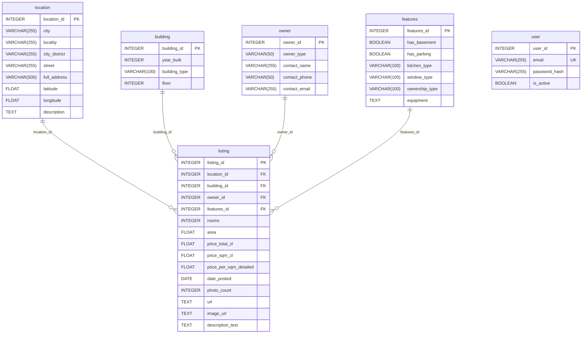

<!-- PLIK GENEROWANY AUTOMATYCZNIE przez services/backend/scripts/gen_model_docs.py -->
<!-- Nie edytuj ręcznie: zmień sql_app/models.py i uruchom generator (hook Claude Code robi to sam po zapisie models.py). -->

# Modele danych (SQLAlchemy)

Źródło: `services/backend/sql_app/models.py`. Modeli: 6.

| Model | Tabela | Kolumn | Relacji |
|---|---|---|---|
| [Building](#building) | `building` | 4 | 1 |
| [Features](#features) | `features` | 7 | 1 |
| [Location](#location) | `location` | 9 | 1 |
| [Owner](#owner) | `owner` | 5 | 1 |
| [User](#user) | `user` | 4 | 0 |
| [Listing](#listing) | `listing` | 15 | 4 |

## Diagram ER

## Building

Tabela `building`. Kolumn: 4, relacji: 1.

| Kolumna | Typ | Null | Klucz | Uwagi |
|---|---|---|---|---|
| `building_id` | INTEGER | nie | PK | indeks |
| `year_built` | INTEGER | tak |  |  |
| `building_type` | VARCHAR(100) | tak |  |  |
| `floor` | INTEGER | tak |  |  |

Relacje:

- `listings` → **Listing** (jeden-do-wielu, `back_populates=building`)

## Features

Tabela `features`. Kolumn: 7, relacji: 1.

| Kolumna | Typ | Null | Klucz | Uwagi |
|---|---|---|---|---|
| `features_id` | INTEGER | nie | PK | indeks |
| `has_basement` | BOOLEAN | tak |  |  |
| `has_parking` | BOOLEAN | tak |  |  |
| `kitchen_type` | VARCHAR(100) | tak |  |  |
| `window_type` | VARCHAR(100) | tak |  |  |
| `ownership_type` | VARCHAR(100) | tak |  |  |
| `equipment` | TEXT | tak |  |  |

Relacje:

- `listings` → **Listing** (jeden-do-wielu, `back_populates=features`)

## Location

Tabela `location`. Kolumn: 9, relacji: 1.

| Kolumna | Typ | Null | Klucz | Uwagi |
|---|---|---|---|---|
| `location_id` | INTEGER | nie | PK | indeks |
| `city` | VARCHAR(255) | tak |  |  |
| `locality` | VARCHAR(255) | tak |  |  |
| `city_district` | VARCHAR(255) | tak |  |  |
| `street` | VARCHAR(255) | tak |  |  |
| `full_address` | VARCHAR(500) | tak |  |  |
| `latitude` | FLOAT | tak |  |  |
| `longitude` | FLOAT | tak |  |  |
| `description` | TEXT | tak |  |  |

Relacje:

- `listings` → **Listing** (jeden-do-wielu, `back_populates=location`)

## Owner

Tabela `owner`. Kolumn: 5, relacji: 1.

| Kolumna | Typ | Null | Klucz | Uwagi |
|---|---|---|---|---|
| `owner_id` | INTEGER | nie | PK | indeks |
| `owner_type` | VARCHAR(50) | tak |  |  |
| `contact_name` | VARCHAR(255) | tak |  |  |
| `contact_phone` | VARCHAR(50) | tak |  |  |
| `contact_email` | VARCHAR(255) | tak |  |  |

Relacje:

- `listings` → **Listing** (jeden-do-wielu, `back_populates=owner`)

## User

Tabela `user`. Kolumn: 4, relacji: 0.

| Kolumna | Typ | Null | Klucz | Uwagi |
|---|---|---|---|---|
| `user_id` | INTEGER | nie | PK | indeks |
| `email` | VARCHAR(255) | nie | UK | indeks, unikat |
| `password_hash` | VARCHAR(255) | nie |  |  |
| `is_active` | BOOLEAN | nie |  | domyślnie True |

## Listing

Tabela `listing`. Kolumn: 15, relacji: 4.

| Kolumna | Typ | Null | Klucz | Uwagi |
|---|---|---|---|---|
| `listing_id` | INTEGER | nie | PK | indeks |
| `location_id` | INTEGER | nie | FK → `location.location_id` |  |
| `building_id` | INTEGER | nie | FK → `building.building_id` |  |
| `owner_id` | INTEGER | nie | FK → `owner.owner_id` |  |
| `features_id` | INTEGER | nie | FK → `features.features_id` |  |
| `rooms` | INTEGER | tak |  |  |
| `area` | FLOAT | tak |  |  |
| `price_total_zl` | FLOAT | tak |  |  |
| `price_sqm_zl` | FLOAT | tak |  |  |
| `price_per_sqm_detailed` | FLOAT | tak |  |  |
| `date_posted` | DATE | tak |  |  |
| `photo_count` | INTEGER | tak |  |  |
| `url` | TEXT | tak |  |  |
| `image_url` | TEXT | tak |  |  |
| `description_text` | TEXT | tak |  |  |

Relacje:

- `building` → **Building** (wiele-do-jednego, `back_populates=listings`)
- `features` → **Features** (wiele-do-jednego, `back_populates=listings`)
- `location` → **Location** (wiele-do-jednego, `back_populates=listings`)
- `owner` → **Owner** (wiele-do-jednego, `back_populates=listings`)
